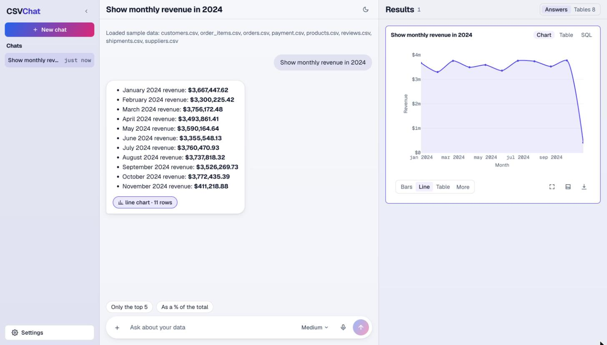
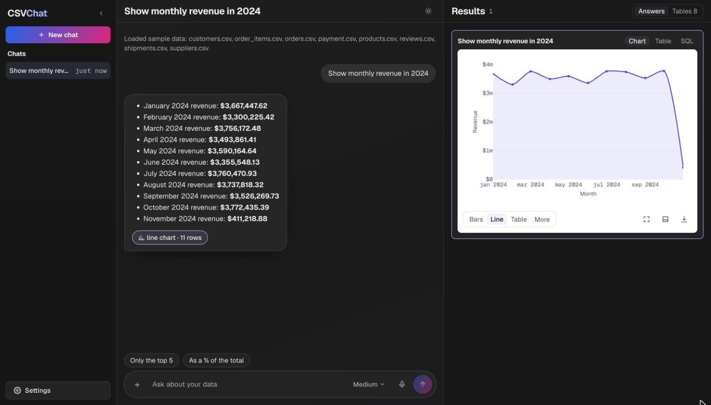

# CSVChat: chat with your CSV files

Upload one or more CSV files, ask questions in plain English, and get an answer in words, a chart, or both.





---

## The problem

A lot of useful data sits in CSV files: sales, orders, customers, payments. To get answers from it today, you need to know Excel formulas, SQL or Python. Most people don't.

They want to type a question like *"Which product sold the most last month?"* and get a clear answer and a chart, in a few seconds.

## What the app can do

- Upload several CSV files at once by dragging them in, picking them, or pasting a link (Google Drive, Google Sheets, Dropbox, GitHub or a direct link).
- Try it with no files of your own: the **Try sample data** button loads the "Online Shop 2024" files (8 tables).
- Ask questions in plain English, including follow-ups like "now only for 2024" or "show it by month".
- Choose the **effort** in the question box: Low (fastest), Medium (the default) or High (most careful, slower).
- The screen has three panels:
  - **Chats** on the left. Hover over a chat to **rename** it (pencil) or **delete** it (bin, after a confirm). Double-clicking a name also renames it.
  - **The conversation** in the middle. Answers are short and easy to read, with **bold** numbers and bullet lists, and a small chip such as "line chart · 11 rows".
  - **Results** on the right: every chart, table and SQL query of the open chat, one card per answer, newest at the bottom. Each card has **Chart**, **Table** and **SQL** tabs. Clicking an answer's chip in the conversation scrolls to its card. **Tables** switches the panel to the cleaned tables: their columns (with the original CSV headers and plain types like number, date, text), the cleaning steps and the links between tables. Drag the panel's left edge to resize it.
- Charts and tables sit on **white cards**, so they read the same in light and dark mode.
- Switch charts between bars, line, pie and more, open them full screen, and download the chart as a picture or the results as a CSV file.
- Every chat has its own address, `/chat/<chat id>`. Reloading keeps you in the chat, and Back and Forward move between chats. Anyone with the address can open that chat, so share it only with people who should see the data.
- If a question is unclear, the app asks you a question back instead of guessing.
- Suggested questions to get you started, and follow-up ideas after each answer.
- **Light and dark mode** (the sun/moon button; it follows your system setting until you choose), and asking by voice in browsers that support it.
- On smaller screens Results slides over the chat, and on phones a Chat / Results switch sits at the top.

---

## How it works

The AI never does the maths. A database does the maths, and the AI only writes the question for the database and explains the result. This keeps the numbers exact.

1. **You upload files.** Each CSV is cleaned and saved as its own table in a small database (DuckDB) that belongs to your chat only.
2. **Cleaning.** The app tidies each file and writes down every change it made, so nothing is changed in secret:
   - column names become simple names (`Order ID` → `order_id`)
   - extra spaces are removed
   - empty cells and words like `null` or `n/a` are marked as missing (they are **not** turned into 0)
   - fully empty rows and exact duplicate rows are removed and counted
   - numbers, dates and true/false values are detected
   - unusual values (outliers) are flagged but kept
3. **Finding links.** The app looks for columns that connect tables, like `order_id` in both `orders` and `order_items`, so questions can use more than one file.
4. **You ask a question.** The AI gets the table names, column names and a few example values (not your whole file). It writes one database query (SQL), or asks you a question back if yours is unclear.
5. **Safety check, then run.** The app checks that the query only reads data and can't change or delete anything. Then it runs the query with a time limit.
6. **The answer.** Short results are put into words by the app itself, with no second AI call: no rows, a single number ("Order count: **15,000**"), one short row, up to 5 labelled numbers, a short list, or a list of columns (every column, with its original header and type). Longer results go back to the AI, which writes a short answer using only those numbers. The app also picks a chart if the result suits one.

```
your question ──> AI writes SQL ──> safety check ──> database runs it ──> AI explains the real result
                                                                      └──> chart + table
```

**When the AI service is busy.** Groq's free tier allows only a few requests a minute. When it answers "busy" (HTTP 429), the app waits as long as Groq asks and tries again by itself, as long as the question's 60-second limit allows. With a second key (`GROQ_FALLBACK_API_KEY`), it switches to whichever key is free sooner. If Groq asks for a longer wait than the time left, you're told how many seconds to wait.

**Why not send the whole file to the AI?** Files can be far too big, and AI models are bad at adding up thousands of numbers. A database is fast and exact.

---

## Run it with Docker (easiest)

You need [Docker Desktop](https://www.docker.com/products/docker-desktop/) and a free Groq key from https://console.groq.com/keys.

```bash
cp .env.example .env     # then open .env and paste your Groq key
docker compose up --build
```

Open http://localhost:3000. The backend runs at http://localhost:8000.

Docker uses ports 3000 and 8000, so stop `npm run dev` and the uvicorn backend first if they are running.

Uploaded files are kept in a Docker volume, so they survive a restart. To stop, press `Ctrl+C`. To stop and delete the uploaded files too, run `docker compose down -v`.

## Run it without Docker

You need Python 3.13 with [uv](https://docs.astral.sh/uv/), Node.js 20 or newer, and a Groq key.

**Settings** (once, in the project folder):

```bash
cp .env.example .env          # then paste your Groq key into .env
```

**Backend** (first terminal):

```bash
cd backend
uv sync
uv run uvicorn chatapp.main:app --reload --port 8000
```

**Frontend** (second terminal):

```bash
cd frontend
npm install
npm run dev
```

The frontend needs no settings file when you run it this way, because it uses `http://localhost:8000` by default.

Open http://localhost:3000.

**Run the tests:**

```bash
cd backend && uv run pytest
cd frontend && npm run lint
```

## Settings

There is one settings file for the whole app: `.env` in the project folder. Copy it from `.env.example`. All settings are optional except the Groq key.

The `.env` file is never committed to GitHub (it's listed in `.gitignore`). The backend gets every setting. The website only gets the backend address, so your Groq key never ends up in the browser.

| Setting | What it does | Default |
|---|---|---|
| `GROQ_API_KEY` | Your Groq key (required) | none |
| `GROQ_FALLBACK_API_KEY` | A second Groq key, used when the first is busy, refused or down | none |
| `GROQ_MODEL` | Which AI model to use | `openai/gpt-oss-20b` |
| `MAX_UPLOAD_MB` | Largest file allowed | `50` |
| `QUESTION_DEADLINE_SECONDS` | Longest time one question may take | `60` |
| `SESSION_TTL_SECONDS` | How long unused chats and their files are kept | `86400` (1 day) |
| `CORS_ORIGINS` | Which website addresses may call the backend | `http://localhost:3000` |
| `NEXT_PUBLIC_API_URL` | The backend address the website uses (Docker only; it's set when the site is built) | `http://localhost:8000` |

The full list is in `backend/src/chatapp/config.py`.

---

## Libraries used and why

**Backend (Python)**

| Library | Why |
|---|---|
| FastAPI | Makes the web API quickly and checks every request. |
| Pydantic | Checks that data has the right shape, including the AI's reply. |
| DuckDB | A small, fast database that runs inside the app. No separate database server is needed, and it's great for questions like totals and averages. |
| pandas | Reads and cleans the CSV files. |
| Groq | Runs the AI model (`gpt-oss-20b`). It's very fast and has a free tier. |
| httpx | Downloads CSV files from links. |
| uvicorn | Runs the backend server. |
| python-dotenv | Reads the Groq key from the `.env` file. |
| uv | Installs Python packages, with exact versions saved in `uv.lock`. |
| pytest | Runs the tests. |

**Frontend (website)**

| Library | Why |
|---|---|
| Next.js + React | Builds the website and its pages. |
| Tailwind CSS | Quick, consistent styling, plus light and dark mode. It runs through PostCSS (`@tailwindcss/postcss` in `postcss.config.mjs`), the standard setup for Next.js. |
| Plotly | Charts with hover details, zoom and download as a picture. |

---

## How we check that it works

### 1. Are the answers right?

- **Automated tests** (`uv run pytest`) cover cleaning, the safety check, chart checks, sessions, uploads and the API. The AI is replaced by a fake in tests, so they're fast and always give the same result.
- **Accuracy check.** Write a list of questions about the sample data, each with a hand-written correct SQL query. Ask the app each question and compare its result table with the correct one. The score is the share of questions answered right.
- The questions mix easy ones ("how many orders?"), ones that join tables ("revenue by product category"), dates ("orders per month in 2024") and unclear ones ("show me the best"), where the right result is a question back.
- Ask the same question in different words to see if the answer stays the same.
- Check that the numbers in the written answer match the numbers in the table.
- Every answer shows its SQL and its table, so a person can always check it.

### 2. Does it cope with big files?

- Files up to 5 MB are accepted (this can be changed). They're saved to disk in small pieces, not held in memory all at once.
- DuckDB handles millions of rows quickly. The slow part is cleaning, which reads the whole file.
- **How to measure:** time the upload and cleaning for files of about 1 MB, 10 MB and 50 MB, time a few questions on each, and watch memory use.
- Only up to 500 result rows are sent to the browser, and each query has a 15-second limit.

### 3. Tricky files and questions it handles

| Case | What happens |
|---|---|
| Not UTF-8 (for example, exported from old Excel) | Read as Latin-1, and this is noted. |
| Separated by `;`, tab or `\|` instead of commas | Detected automatically. |
| Messy or repeated column names | Renamed to simple, unique names. |
| Empty cells, `null`, `n/a` | Kept as missing, never turned into 0. |
| Empty rows and duplicate rows | Removed and counted. |
| A row with too many values | The file is refused with a clear reason, instead of losing data. |
| A row with too few values | The missing values are marked as missing, and this is noted. |
| Dates that could be day/month or month/day | Kept as text instead of guessing, with a cleaning step saying so. |
| Dates in mixed formats (`2024-01-05` and `05/04/2024`) | Every date whose meaning is clear is written as `YYYY-MM-DD`. If a value like `25/04/2024` shows the column is day first, the whole column becomes a date. If some values could still be either, the column stays text and a cleaning step says why. The AI sees the same note. |
| A column of dates with a few other values (`TBD`) or impossible dates (`2024-02-30`) | Kept as text, with a cleaning step that names the odd values. |
| Numbers with leading zeros (zip codes) | Kept as text. |
| An empty file, or one that isn't a CSV | Refused with a clear message. |
| A link to a private or local address | Blocked. |
| A vague question | The app asks a question back. |
| "Hi" or "what can you do?" | A short friendly reply, with no query. |
| A query that fails | The error goes back to the AI once to fix it. If it still fails, you get a clear message. |
| Text inside a file that looks like an order to the AI | Treated as plain data, never followed. |
| The AI is busy (rate limit) | Waits as long as Groq asks and tries again, within the 60-second limit. |
| The AI is slow | Stops after 60 seconds with a clear message. You can also press Stop. |

---

## Limits and next steps

- **No login.** Each chat is tied to a random ID in its address and in your browser's chat list. The **Log out** button in Settings is a placeholder for now. A real product would need user accounts.
- **One server.** Chats are stored on that server's disk. Running many servers would need shared storage.
- **Big files** are cleaned in memory, so very large files (hundreds of MB) would need a background job.
- **The AI can still misunderstand a question.** That's why the SQL and the table are always shown.

---

## Folder map

```
backend/
  src/chatapp/       cleaning, the database for each chat, AI calls, settings
  src/api/route/     the API addresses (upload, chat, history and more)
  src/schemas/       the shape of every request and reply
  tests/             automated tests
  Online Shop 2024/  sample data
docs/screenshots/    the pictures in this README
frontend/
  app/               the pages (home page, and /chat/[[...session]] for /chat and /chat/<id>)
  components/        chat, chart and upload pieces
  hooks/, lib/       loading data and talking to the backend
docker-compose.yml   starts the backend and frontend together
.env.example         the one settings file (copy it to .env)
```

## Main API addresses

| Address | What it does |
|---|---|
| `POST /files` | Upload one or more CSV files |
| `POST /files/url` | Add a CSV from a link |
| `POST /files/sample` | Load the sample data |
| `GET /files` | List the tables in a chat |
| `DELETE /files/{name}` | Remove a file |
| `POST /chat/stream` | Ask a question (shows progress while it works). Takes `message`, `session_id` and `effort` (`low`, `medium` or `high`) |
| `POST /query` | Re-run a saved answer by its id (used to redraw charts when a chat is reopened) |
| `GET /sessions/{id}/history` | Get the messages of a chat |
| `DELETE /sessions/{id}` | Delete a chat with its files, tables and history |
| `GET /health` | Check the server is up and the Groq key is set |

Full, clickable API docs are at http://localhost:8000/docs while the backend is running.
